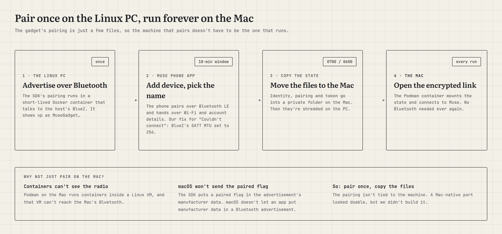
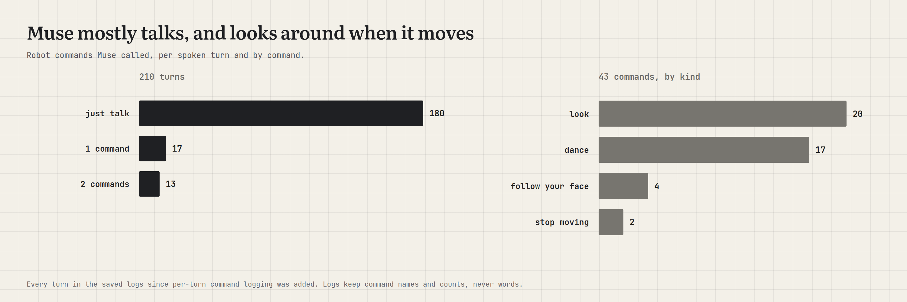
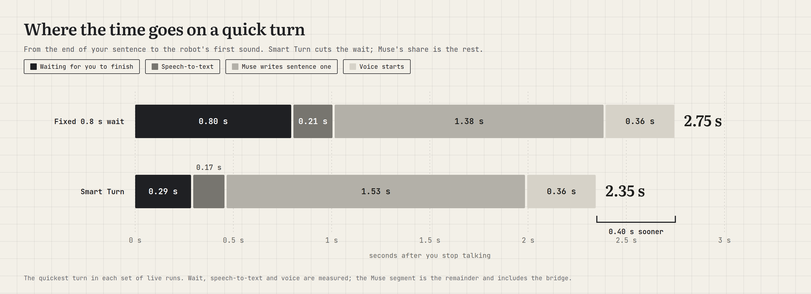
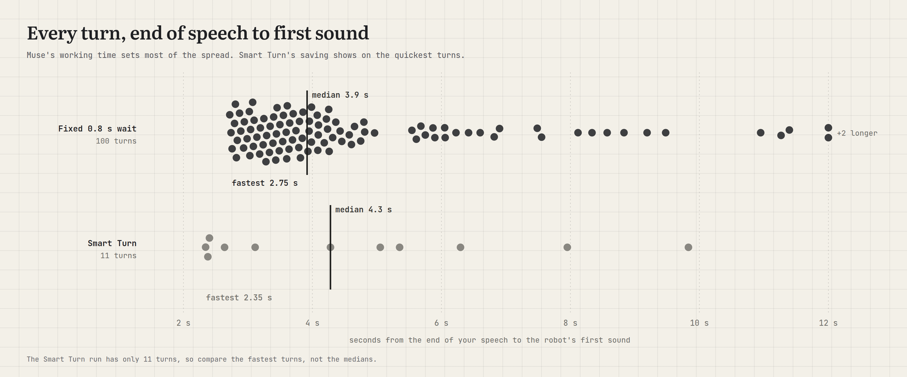
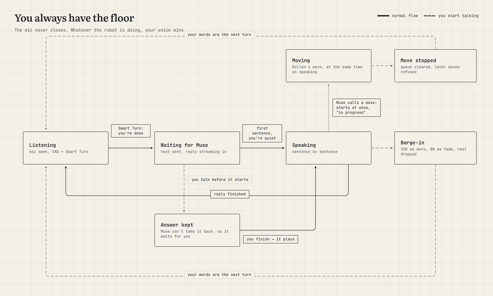
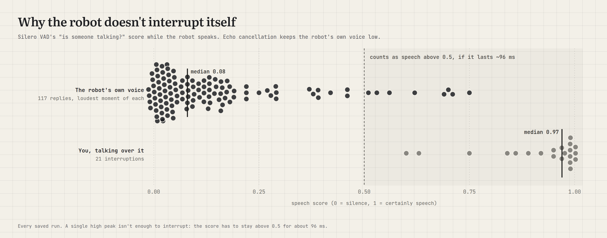
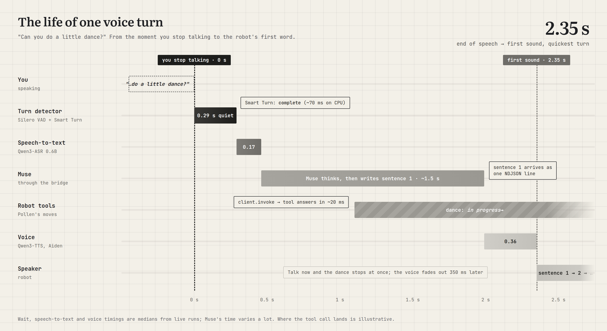

Most voice assistants are good at answering. We wanted one on the desk that would take a job off our hands. Ask it to research something, plan a trip, check the calendar, draft an email or add to a list, and it goes and does it. When the work takes a while, it says so, keeps going in the background, and comes back with a short spoken summary. The full result waits in the Muse app.

It also has a body. It looks at you, nods along while it talks, dances when asked, and stops the moment you say "wait".

This post is about how we got there: the robot, the brains we tried before settling on Muse, and the work it took to make a text-based agent feel like someone you can talk to.

## The robot: Reachy Mini

[Reachy Mini](https://huggingface.co/docs/reachy_mini/index) is a small open-source desktop robot from Pollen Robotics, which Hugging Face bought in 2025. It's about 28 cm tall, with a head that can tilt and turn in six directions, a body that rotates, two expressive antennas, a wide-angle camera, four microphones and a speaker.

It comes in two versions. The **Wireless** version has its own computer, battery and Wi-Fi. The **Lite**, which we use, has no computer inside: it plugs into a Mac or Linux machine over USB, and that machine does all the thinking. A background program called the daemon drives the motors, camera and audio, and apps talk to it over a local API. There's an app store built on Hugging Face Spaces, so you can install new behaviours with one click.

The flagship app is Pollen's [conversation app](https://github.com/pollen-robotics/reachy_mini_conversation_app). You talk, it talks back, and the head wobbles in time with its voice. It comes with tools for the body (dance, emotions, look around, follow your face, use the camera) and a few helpers like web search, weather and simple memory. It's a charming companion. But it's built for chatting, not for taking on a job that needs your email, your calendar or an afternoon of research.

## Looking for a brain

The robot's body was the easy part. The question was what should think for it. We tried a few answers.

**A fully local brain.** First we ran everything on our own machine: an open model through Ollama, local speech-to-text and text-to-speech, and nothing leaving the computer. It worked, and it was private. But every skill was ours to build. Reminders, timers, lists, a calculator, a radio, a storyteller, wake words for two personas: each one was code we wrote and maintained. The assistant could only ever do what we had time to teach it. (The local version, still a work in progress, is on the [`main` branch](https://github.com/tysonthomas9/local-assistant) of our repo.)

**OpenClaw.** Next we tried [OpenClaw](https://docs.openclaw.ai), the popular open-source personal agent. It runs on your own machine with your own model keys, talks to you through messaging apps, and learns new abilities from shared "skills". There's even a community skill for driving a Reachy Mini. It's very capable. It's also yours to look after: you host it, pick and pay for the model, choose which skills to trust, and keep it on an isolated machine, because an agent that can act on your computer is an agent that can break it.

**Muse.** [Muse](https://about.fb.com/news/2026/09/introducing-muse-personal-ai-agent/) is Meta's personal AI agent, launched in September 2026. You tell it what needs doing and it does the work: emails, travel, filling in forms in a browser, planning toward a goal. It connects to your apps, remembers what matters to you, and keeps working after you close the app, coming back when something changes or when it needs your approval. It runs in its own secure virtual machine, with a separate guard agent that has to approve anything it sends to the internet. For us, the big difference was that all of this is someone else's job to run. The robot only has to be a good pair of ears, a voice and a body.

| | OpenClaw | Muse |
|---|---|---|
| **Where it runs** | Our machine or server | Meta's cloud, in a VM per person |
| **Who builds the skills** | Us, plus shared community skills | Muse, with its connectors |
| **Long tasks** | Yes | Yes, with approvals and background work |
| **Who looks after it** | We do | Meta does |
| **How the robot plugs in** | API | A Muse gadget |

That last row is what made Muse possible here.

<aside class="pull">Other always-on agents have arrived recently, such as xAI's Grok Bot and OpenAI's dots, but Muse is the only one we found with an SDK for your own hardware.</aside>

## Making the robot a Muse gadget

Muse "gadgets" are devices you build yourself and pair with your Muse account. Meta publishes an open-source [Gadget SDK](https://github.com/facebookincubator/muse-gadget-sdk) in two flavours: one for small ESP32 boards with a screen or a button, and a **Linux Device SDK** that turns any Linux computer into a gadget. Pairing works over Bluetooth with the Muse phone app, and you need a developer token from [gadgets.muse.ai](https://gadgets.muse.ai).

A gadget does two things. It can send messages to Muse, and it can offer commands that Muse is allowed to call, each with a description and typed settings. Muse reads the descriptions and decides when to use them, just as it decides when to check your calendar.

So the robot offers Muse six commands: show an emotion, dance, stop moving, look in a direction, follow your face, and report its own status. Each one runs one of Pollen's own moves. Ask Muse to "look excited about the trip" and it can play the robot's happy emotion while it reads you the itinerary.

The SDK also comes with commands to run shell programs and read and write files. We removed those, and refuse them again if they ever arrive. Muse can move the robot, and that's all it can do to the computer.

## A walkie-talkie, not a phone call

Here's the catch that shaped most of the project.

Pollen's app was built for a **realtime voice model**. Its backend, Hugging Face's hosted service, speaks the same protocol as OpenAI's Realtime API: one live connection with audio flowing both ways the whole time. The server hears your voice, decides when you've finished, answers in speech, and stops itself when you interrupt. It's like a phone call.

Through the gadget SDK, Muse works like a **walkie-talkie**. The SDK doesn't expose a realtime voice endpoint: a gadget sends a message, and a message comes back, as text. There's no live audio connection and no voice on the way out.

That isn't a speed problem. Muse hands long-running work to sub-agents, so the main chat still answers in near real time. The gap is the voice layer around the words, and that we could build ourselves.

| | Realtime voice model | Muse gadget SDK |
|---|---|---|
| **Connection** | One live audio stream | A message, then a reply |
| **What it hears** | Your voice | Text |
| **What it sends back** | Speech | Text, which we turn into speech |
| **Knowing you've finished** | The server decides | We decide |
| **When you interrupt** | The server stops its answer | We fade out and stop listening for the rest |
| **Taking a message back** | Possible | Not once it's sent |
| **What it can do** | Talk, and call a few tools | Real tasks, over minutes if needed |

*These limits come from the gadget SDK, the way a device talks to Muse today, not from Muse itself.*

So everything a realtime model does around the words became our job, on the Mac: hearing when you speak, deciding you're done, turning speech into text, turning the reply back into speech, and handling interruptions. Muse can accept audio, but we chose to transcribe it ourselves so we control the whole conversation: exactly when a turn ends, whether a reply is held or dropped, which models we use, and the fact that only text ever leaves the Mac.

## When a task takes a while

A research question or a trip plan doesn't fit in one breath. Muse doesn't make you wait for it: the main chat replies in near real time, and long-running work goes to sub-agents in the background. So the robot answers right away, often just to say it's on it, and stays free for your next request. When it's done, the robot speaks a short summary, and the full result (the itinerary, the sources, the draft email) is waiting in the Muse app.

That split turned out to be natural. Spoken answers should be short, and nobody wants a robot reading out ten links. The voice gives you the gist; the screen holds the detail. Anything that needs your sign-off, like sending an email, goes through Muse's approval step rather than being decided by a voice in the room.

## How it fits together

Pollen's app runs unchanged on the Mac. We replaced one piece, its realtime backend, with our own class, `MuseHandler`. The Muse SDK runs next to it in a [Podman](https://docs.podman.io) container (a lightweight, locked-down box for running software) with a small web bridge in front.

One spoken request travels like this:

1. **Hearing you.** [Silero VAD](https://github.com/snakers4/silero-vad), a tiny voice-activity model, scores every 32 ms of audio for "is someone talking?". When you pause, [Smart Turn](https://github.com/pipecat-ai/smart-turn), an end-of-turn model from the Pipecat project, listens to how you said the last few seconds and judges whether you've actually finished.
2. **Writing it down.** [Qwen3-ASR](https://github.com/QwenLM/Qwen3-ASR) 0.6B turns your speech into text, on the Mac.
3. **Doing the work.** `MuseHandler` sends the text to the bridge, and the gadget passes it to Muse over an encrypted link.
4. **Moving.** If Muse wants the robot to move, it calls one of the six robot commands. Our endpoint checks it and runs Pollen's move.
5. **Speaking.** Muse's reply streams back one sentence at a time, and each sentence goes straight to [Qwen3-TTS](https://github.com/QwenLM/Qwen3-TTS) 1.7B, speaking as the voice "Aiden".

Letting a cloud agent drive hardware on your desk deserves care, so the setup is locked down:

- **Muse can only move the robot.** No shell, no files, no camera, no volume. Just a health check and the six robot commands, checked on both sides.
- **Nothing listens on the network.** Every service is on the Mac's own loopback address.
- **Every run has its own secret.** Robot commands need a random secret made fresh for each run, so nothing else on the Mac can drive the robot.
- **The container is boxed in.** It runs as a regular user with no special permissions and a read-only filesystem.
- **Your words stay your words.** Nothing is added to what you say, and the logs record lengths and timings, never content.
- **Meta's SDK is untouched.** It's pinned to one version and never edited. Everything robot-specific lives in our own wrapper.

## Three things that fought back

### Pairing a Mac over Bluetooth

A gadget pairs with the phone over Bluetooth Low Energy, using Linux's Bluetooth stack. Our gadget runs in a container on a Mac, and containers on a Mac live inside a small Linux virtual machine that can't see the Mac's Bluetooth radio.

Pairing from macOS directly wasn't an option either. The gadget advertises a "paired" flag inside its Bluetooth advertisement, and macOS [doesn't let apps add that kind of data](https://developer.apple.com/documentation/corebluetooth/cbperipheralmanager/startadvertising%28_%3A%29) to an advertisement. The phone would never see it.

The way out was noticing that a pairing is just a handful of files. So we pair once on a Linux PC, copy the files to the Mac, and wipe them from the PC. From then on the Mac carries on as if it had paired itself.

### Hearing Muse's answers

Sending Muse a message is well documented. Reading its reply took some digging. The obvious endpoint only acknowledges the message, and the chat history is off limits to a gadget. The answer was in the same repo, in Meta's own firmware for the ESP32 gadgets: open an event stream first, then send the message, and collect the reply as it streams in. Robot commands arrive on that same stream as a request we have to answer, which isn't in the docs. Once we answered those, the robot danced on request.

### Dancing while talking

Muse calls its commands first and writes its reply after. At first, Pollen's dance command answered "queued", Muse took that as finished, and happily described a dance the robot had barely started. Holding the move until the robot had finished talking meant it never talked and moved at the same time. Waiting for the dance to finish before answering made Muse accurate, but the robot stood silent through the whole dance.

The fix came from a question during testing: *"Can it not move and talk at the same time?"* Now the move starts at once and Muse is told it's "in progress". It no longer claims the dance is done, and the robot talks while it dances.

Muse uses the body less than you might expect. Most requests are about the task, and when it does move, it mostly looks around.

## Making it quick

An assistant you talk to has to answer like a person would, without a long silence. Our first version waited for Muse's whole reply, about 3.7 s, before speaking a word. Three changes made it feel much quicker.

**Speak sentence by sentence.** The bridge passes on each sentence the moment Muse finishes it. The robot starts speaking the first while Muse is still writing the second, about 0.36 s after the sentence arrives.

**Pick the right speech-to-text.** Everything runs on the Mac through Apple's [MLX](https://github.com/ml-explore/mlx) framework, so we could try several open models side by side. Two of them come from NVIDIA:

- **[Parakeet TDT 0.6B v3](https://huggingface.co/nvidia/parakeet-tdt-0.6b-v3)**, a fast, accurate model for 25 European languages. It was our first choice, and it's what our fully local brain still uses.
- **[Nemotron 3.5 ASR](https://huggingface.co/mlx-community/nemotron-3.5-asr-streaming-0.6b)**, NVIDIA's newer 0.6B streaming model. It writes text while you're still talking, keeping a cache of what it has already heard so it only processes new audio, and you can choose how far ahead it waits before committing to a word. It covers 40 language-locales. We tested it both streaming, with a 320 ms look-ahead, and offline over the whole clip.

Against them we put Alibaba's **[Qwen3-ASR](https://github.com/QwenLM/Qwen3-ASR)** in two sizes. All five ran on the same twelve clips. Word error rate (WER) is the share of words a model gets wrong, so lower is better. It's a small test, so treat it as a sanity check.

| Model | WER, clean | WER, noisy | Text ready after you stop |
|---|---|---|---|
| NVIDIA Parakeet TDT 0.6B v3 | 1.3% | 0.0% | 126 ms |
| NVIDIA Nemotron 3.5 ASR, streaming | 0.0% | 11.1% | 111 ms |
| NVIDIA Nemotron 3.5 ASR, offline | 0.0% | 5.6% | 393 ms |
| **Qwen3-ASR 0.6B** | **0.0%** | **0.0%** | **227 ms** |
| Qwen3-ASR 1.7B (8-bit) | 0.0% | 0.0% | 359 ms |

We expected Nemotron's streaming to win, since its text is ready almost the moment you stop. It was the fastest, but it stumbled on the noisy clips. More importantly, speed here didn't matter: every model had its text ready long before the robot decided you'd finished. The model wasn't the bottleneck; the waiting was. Qwen3-ASR 0.6B was accurate on every clip and heard us best in live use, so it became the default, with Parakeet as the fallback.

**Stop guessing from silence.** The robot used to decide you'd finished after 0.8 s of silence. That's a long pause in every exchange. Cutting it to 0.5 s chopped people off mid-sentence. In one 40-turn run, seven requests were sent after a few characters, and the tester's verdict was: *"I was talking and part of the message got sent before I finished."*

So we let a model decide. After about 0.3 s of quiet, Smart Turn v3.2 listens to the last eight seconds of your voice, picking up cues like tone and pace, and judges whether you sound finished. It takes about 70 ms on the Mac's processor. If you sound done, the turn ends right there. If you trailed off ("can you look up the…"), it waits for you, for up to 2 s.

The time from the end of your speech to the text being ready fell from about a second to about half that. On quick exchanges, the robot now starts talking 2.35 to 2.64 s after you stop, where 3.4 to 4.0 s used to be typical.

Muse's own thinking time is still the biggest and most variable part, as the chart below shows. That's expected for an agent that might be checking your calendar or searching the web. Smart Turn saves half a second on the part we control, and you notice it most in quick back-and-forth.

## Taking turns politely

A desk assistant you can't interrupt is exhausting. Our rule was: **you always have the floor.** The microphone stays open the whole time, while you talk, while Muse works, while the robot moves and while it speaks. When you start talking, the robot yields.

### Interrupting the robot

Cutting in on someone mid-sentence is called **barge-in**. With the mic always open, the risk is that the robot hears its own voice and interrupts itself. The robot's microphone board has a voice chip, the XMOS XVF3800, that does **echo cancellation**: it knows what the speaker is playing and subtracts it from what the mics hear. We trusted it, with Pollen's tuned settings, and measured.

Your speech only counts as an interruption once it lasts about 96 ms. Then the robot keeps talking for 350 ms, fades out over 80 ms, drops the rest of its reply, and answers what you said.

The numbers back it up. While the robot talks, its own voice scores a median of 0.08 on the "is someone talking?" scale. A person talking over it scores 0.95 to 1.0 most of the time. The rare echo spikes above the 0.5 threshold are too short to count. In one 33-turn run the robot never interrupted itself, and all five real interruptions faded out within 359 to 370 ms.

### "Wait!" stops the dance

The moment your voice starts, any move Muse started stops, and the head holds still. Muse can't start another move for the rest of that turn. Following your face isn't a move, so it carries on.

### Muse can't take a message back

You finish a request, the robot sends it, and then you add "…and make it a cheap one" before the answer plays. Our first idea was to throw away the pending answer and send both parts as one request. But Muse had already received the first part, and it can't be withdrawn. Joining them made Muse answer twice.

This is the walkie-talkie again: once you let go of the button, the message is gone. So the robot keeps the answer. If you're still talking when it's ready, it waits until you finish, plays it, and your addition becomes the next request. It never talks over you.

### One transcript, not two

We tried transcribing at every pause so the text would be ready sooner. Compared with one pass over the whole request, the two disagreed in 10 of 33 turns. For an assistant that's going to act on your words, accuracy wins.

## One request, start to finish

Here's a single "can you do a little dance?", from the end of your sentence to the robot's first word.

## What's still rough

**Dropped connections.** Once, Muse's connection reset mid-session. The SDK reconnected by itself about 17 s later, but a bug in our error handling failed the request in flight, and three requests got a spoken "can't reach Muse". A drop should be a short pause, and we're fixing it.

**No wake word.** The robot treats anything said nearby as a request, so stray noises sometimes reach Muse as nonsense like "VT". Once, a noise stopped a dance 0.2 s in. Ignoring very short scraps, and only stopping moves on words like "stop" or "wait", would help.

**Its own name.** "Reachy" isn't a common word, and speech-to-text sometimes mishears it.

**Laughter.** Laugh at the robot's joke and nothing happens: the voice detector is trained on talking, speech-to-text writes down words, and Muse only gets text. A small laughter detector could pass "(laughs)" along.

**Real pauses.** Smart Turn has had one live run of twelve requests so far, and none had a real mid-sentence pause. In recorded tests it kept a paused question together where the old fixed wait split it in two, but it needs more live use.

## What we'd tell someone starting out

1. **Pick the brain for the jobs, not the chat.** A good conversationalist isn't the same as an assistant that gets things done. Let the agent do the work, and let the robot be its body.
2. **Know whether your brain is a phone call or a walkie-talkie.** With a message-in, message-out agent, all of the conversational feel is yours to build.
3. **Keep the voice short and put the detail on a screen.** The robot speaks the summary; the app holds the itinerary.
4. **Read the firmware, not just the docs.** Meta's own gadget firmware showed us how replies really flow.
5. **Measure the echo before you fear it.** Echo cancellation made an always-open mic practical.
6. **Look at the waiting before the models.** Our slow part was deciding you'd finished, not speech-to-text, so even NVIDIA's streaming model couldn't help.
7. **Design around what can't be undone.** Once Muse has your message, it will act on it.

The result is a little robot that listens all the time, takes jobs off your plate, dances when asked, stops when you say "wait", and waits its turn. Most of the time, anyway.

## The code

Both brains live in one repo, [tysonthomas9/local-assistant](https://github.com/tysonthomas9/local-assistant), on separate branches that share the same robot setup:

- **Muse version:** the [`muse-gadget-poc` branch](https://github.com/tysonthomas9/local-assistant/tree/muse-gadget-poc). Everything Muse-specific is in [`muse_gadget/`](https://github.com/tysonthomas9/local-assistant/tree/muse-gadget-poc/muse_gadget): the gadget container and bridge, `MuseHandler`, the robot commands and the pairing scripts.
- **Local-only version (work in progress):** the [`main` branch](https://github.com/tysonthomas9/local-assistant). It's still changing and rough in places. Ollama, a local speech server, wake words, two personas and the hand-built tools, with nothing leaving the machine unless you turn on web tools.

## Credits

This project stands on the work of the [Pollen Robotics](https://www.pollen-robotics.com/reachy-mini/) and [Hugging Face](https://huggingface.co/docs/reachy_mini/index) teams behind Reachy Mini. Their open-source [robot SDK and daemon](https://github.com/pollen-robotics/reachy_mini) drive the motors, camera and audio. Their [conversation app](https://github.com/pollen-robotics/reachy_mini_conversation_app) is the app our robot runs, unchanged: the audio loop, the head that wobbles in time with the voice, and the dances, emotions, head moves and face tracking that Muse calls are all theirs. So are the tuned echo-cancellation settings that make an always-open mic work. We swapped out the brain; the body and much of the personality are Pollen's. Both projects are Apache 2.0 licensed.

Thanks also to the open projects in the voice pipeline: [Silero VAD](https://github.com/snakers4/silero-vad), Pipecat's [Smart Turn](https://github.com/pipecat-ai/smart-turn), Alibaba's [Qwen3-ASR](https://github.com/QwenLM/Qwen3-ASR) and [Qwen3-TTS](https://github.com/QwenLM/Qwen3-TTS), NVIDIA's Parakeet and Nemotron models, Apple's [MLX](https://github.com/ml-explore/mlx), and Meta's [Muse Gadget SDK](https://github.com/facebookincubator/muse-gadget-sdk).

---

**P.S.** We'd love to try the same robot with xAI's Grok Bot and OpenAI's dots. Both are always-on agents that take on real tasks, but neither offers an SDK for your own hardware yet. We're waiting. Most of what we built (the listening, the turn-taking, the voice and the robot commands) sits in front of the brain, so when those SDKs arrive, plugging in another agent should mean writing a new bridge, not a new robot.
