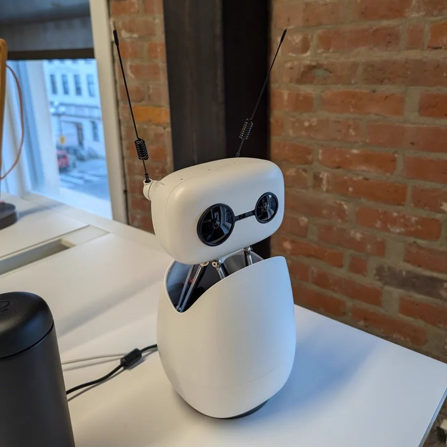

The new wave of AI isn't just about chat windows anymore. It's becoming physical, expressive, and interactive.

At a recent hackathon, the AI Tinkerers OpenClaw Global Unhackathon, I built a simple prototype that connected [Reachy Mini](https://www.pollen-robotics.com/reachy-mini/) (a physical robot) with [OpenClaw](https://github.com/openclaw/openclaw) (a multi-channel AI assistant). What started as an experiment quickly felt like something bigger: not one assistant, but two AI agents working together.

## Why this combo clicked

Reachy Mini brings the human-facing side of AI to life:

- Movement and emotion
- Voice conversations
- A physical presence people naturally engage with

But like many voice-first systems, it can be limited by short context and local capabilities.

That's where OpenClaw came in. OpenClaw became Reachy's extended brain:

- Reading links from Discord
- Summarizing articles
- Keeping context across conversations
- Handling longer, deeper tasks in the background

So Reachy could stay expressive and social, while OpenClaw handled the heavy lifting.



## The hackathon moment

The "aha" moment came when I could say something out loud to Reachy like:

> "I'm sending an article now."

Then I'd drop the link in Discord. OpenClaw would process it, and Reachy could continue the conversation naturally.

That flow felt magical. Voice and chat stopped being separate worlds.

It felt less like using tools, and more like working with a small AI team:

- One teammate in front of you
- One teammate behind the scenes

## A simple but powerful pattern

Together, they formed a clear split of roles:

| Agent | Role |
| --- | --- |
| Reachy | Embodiment, presence, personality, live interaction |
| OpenClaw | Memory, tools, automation, cross-channel intelligence |

That pairing unlocked practical use cases immediately:

- Voice conversations that continue seamlessly in chat
- Real-time article summaries and analysis
- Collaborative prototyping for robotics and AI workflows
- An assistant system that can both entertain and execute

## How it works

Most AI agent setups have one LLM running the show. That works until you have two agents that are good at completely different things. Making one subordinate to the other felt wrong, so Reachy and OpenClaw work side by side. For this project I used OpenClaw's Discord channel as the text interface.

### Architecture

The drawing at the top of this post shows the setup.

Each agent has its own LLM session. Reachy runs OpenAI's Realtime API (`gpt-realtime-1.5`) for low-latency voice. OpenClaw runs a configurable text model with tool use for research. They don't share a context window. They share *summaries* through a bridge.

### The bridge

A lightweight API running alongside Reachy's conversation app on port 8100:

| Endpoint | Direction | Purpose |
|---|---|---|
| `POST /bridge/inject` | OpenClaw → Reachy | Push text into Reachy's voice session |
| `WS /bridge/ws` | Reachy → OpenClaw | Stream voice transcripts in real-time |
| `GET /bridge/status` | Both | Health check |

The interesting part is the `inject` endpoint. It accepts `text`, `image_b64`, and `response_instructions`, which lets you push content into Reachy's session and tell its LLM *how* to respond. OpenClaw can say "summarize these research findings in 2-3 sentences" or "briefly acknowledge this notification." That framing control matters more than it sounds.

### Three plugin hooks

On the OpenClaw side, a plugin (`extensions/reachy-mini/`) connects the two agents through three hooks:

#### 1. `before_prompt_build` — voice context injection

Every time OpenClaw's agent runs (triggered by a Discord message), this hook prepends the last 50 voice transcript lines from Reachy's conversation. OpenClaw sees what the user has been *saying* to the robot, not just what they typed.

```
[Recent voice conversation between user and Reachy Mini robot]
User (voice): I'm sending you a link about quantum computing
Reachy: Got it, I'll keep an eye out for it
[End voice context]
```

So when a user drops a link in Discord, OpenClaw already knows *why*, because they just told Reachy about it out loud.

#### 2. `message_received` — real-time notification

When a Discord message arrives, Reachy gets a heads-up via bridge inject:

> "A user sent a message on Discord. OpenClaw is processing it."

The robot acknowledges it verbally: *"Looks like something just came in on Discord. OpenClaw's on it."* The user gets feedback before the research has even started.

Content is trimmed to ~1,500 tokens to avoid blowing out Reachy's context window.

#### 3. `llm_output` — research forwarding

After OpenClaw finishes processing, its full response goes to Reachy (trimmed to ~10K tokens). Reachy then discusses the findings with the user.

Why `llm_output` instead of `message_sending`? We found out the hard way that Discord same-channel replies bypass the outbound delivery pipeline entirely (`deliverDiscordReply` → `sendMessageDiscord` directly). The `message_sending` hook never fires. `llm_output` fires after every LLM response regardless of delivery path. Subtle, but it cost us real debugging time.

### Full data flow

![A sequence diagram on grid paper titled How a link becomes a conversation, with five columns: You, Reachy Mini, Bridge API, OpenClaw and Discord. 1: you tell Reachy you're sending a link about quantum computing. 2: Reachy streams the voice transcript live through the bridge's WebSocket to OpenClaw, which keeps the last 50 lines. 3: OpenClaw echoes the [You] and [Reachy] lines to the #reachy-log channel. 4: you drop the link in #general. 5: OpenClaw's message_received hook sends Reachy a heads-up through POST /bridge/inject. 6: the before_prompt_build hook puts the voice transcripts in front of the prompt, and the agent works the link with that context. 7: the llm_output hook sends the findings to Reachy, trimmed to about 10K tokens. 8: the reply is posted in #general. 9: Reachy talks you through the findings.](./data-flow.png)

### Bidirectional tasks

The bridge works both ways. Reachy can ask OpenClaw to do things too.

A user says to Reachy: *"Can you ask OpenClaw to look up the latest papers on transformer architectures?"*

Reachy's LLM calls the `ask_openclaw` tool, which sends the task through the bridge. OpenClaw picks it up, runs its agent with browser/research tools, and the response flows back through the existing `llm_output` → bridge inject path.

On Reachy's side, a Python tool:

```python
class AskOpenClaw(Tool):
    name = "ask_openclaw"
    description = "Send a task to OpenClaw, your AI partner on Discord."

    async def __call__(self, deps, **kwargs):
        task = kwargs["task"]
        await deps.bridge_state.broadcast({
            "type": "task",
            "task": task,
        })
        return {"status": "sent", "task": task}
```

The tool broadcasts a `type: "task"` message over the existing bridge WebSocket. No new infrastructure.

On OpenClaw's side, the `TranscriptService` already listens to this WebSocket. It handles `type: "task"` messages by posting them to Discord via webhook. The webhook posts as a different user ("Reachy Mini"), which matters because Discord bots ignore their own messages. The message enters the normal processing pipeline, gets handled, and the response flows back to Reachy through the existing `llm_output` hook.

One subtlety: webhook messages still have `author.bot = true` on the Discord side. OpenClaw's message handler drops bot messages by default. We enable `allowBots` in the Discord channel config so the webhook-posted tasks get processed.

![A diagram on grid paper titled Reachy can hand OpenClaw a job, in two frames. In the Reachy Mini frame: 1, Reachy's LLM hears a request to ask OpenClaw to find transformer papers; 2, the ask_openclaw tool sends a task message over the bridge WebSocket. In the OpenClaw frame: 3, TranscriptService, already listening on that WebSocket; 4, a Discord webhook posts the task as Reachy Mini, with allowBots set to true because webhook posts count as bots; 5, the OpenClaw agent researches with its browser tools; 6, the llm_output hook catches the answer. Back in the Reachy frame: 7, bridge inject posts it into the voice session; 8, Reachy tells you what OpenClaw found. A note says anything that speaks HTTP and WebSocket can plug into the bridge.](./task-loop.png)

Either agent can start a conversation, and the user talks to whichever one is convenient. The bridge is agent-agnostic. Anything that speaks HTTP and WebSocket can plug in, so a third agent (mobile app, Slack bot, another robot) would just be another client.

### Loop prevention

Two agents talking to each other will happily loop forever if you let them. Two guards stop this:

1. Prefix filtering: `message_received` skips messages starting with `[You]` or `[Reachy]` (transcript echoes from the log channel). Stops transcript logs from triggering new notifications.
2. Channel separation: transcript logs go to `#reachy-log`, not `#general`. The agents don't see each other's observability output.

One thing we haven't solved: `llm_output` fires for all LLM completions regardless of trigger. Adding origin tracking would prevent the hook from forwarding responses that were themselves triggered by Reachy content. Works for now.

### Observability

A dedicated Discord channel (`#reachy-log`) shows what's happening in real time:

```
[You] I'm sending you a link about quantum computing
[Reachy] Got it, I'll keep an eye out for it
[→ Reachy] Notified: user sent a message (142 chars)
[→ Reachy] Forwarded OpenClaw response (2847 chars)
[Reachy] OpenClaw found some really interesting stuff about quantum error correction...
```

Every bridge interaction is logged. Failures show up as `[→ Reachy] ERROR ...` messages.

### What surprised us

The `message_sending` hook doesn't fire for Discord replies. This took a while to figure out. Discord's same-channel delivery path shortcuts the entire outbound payload pipeline. We had debug logging confirming the hook was registered, but it never triggered. Switching to `llm_output` fixed it because it fires at the LLM layer, before any channel-specific delivery logic.

macOS microphone permissions block USB audio devices silently. Reachy Mini has its own USB audio device ("Reachy Mini Audio"), and the SDK correctly selects it over the system default. But macOS still requires explicit microphone permission for the terminal process. Both the built-in mic and the USB device read zero until you grant it. We spent an embarrassing amount of time checking audio device selection code when the problem was a permissions dialog we hadn't seen.

Token budgets need active management. Without trimming, a long OpenClaw research response overflows Reachy's Realtime API context window. We cap incoming notifications at ~1,500 tokens (6,000 chars) and responses at ~10K tokens (40,000 chars).

### Stack

| Component | Technology |
|---|---|
| Reachy Mini voice | OpenAI Realtime API (`gpt-realtime-1.5`) |
| Reachy audio | SoundDevice + USB "Reachy Mini Audio" |
| Reachy bridge | FastAPI on port 8100 |
| OpenClaw agent | Local-first personal AI assistant, configurable LLM with tool use |
| OpenClaw channels | Discord for this project (also supports Telegram, WhatsApp, Slack, Signal, iMessage, etc.) |
| Plugin bridge | TypeScript extension with WebSocket + HTTP |
| Robot control | Zenoh pub/sub via reachy-mini SDK |

### Running it

```bash
# Terminal 1 — OpenClaw gateway + Discord bot
pnpm openclaw gateway run --force

# Terminal 2 — Reachy conversation app
cd reachy_mini_conversation_app
source .venv/bin/activate
reachy-mini-conversation-app --no-camera
```

Check for `Transcript WebSocket connected` in OpenClaw logs and `Bridge WS client connected` in Reachy logs.

### Code and setup

The full implementation is across two repos:

- **OpenClaw extension** (bridge plugin, hooks, task reception): [openclaw/openclaw — feature/reachy-mini-extension](https://github.com/openclaw/openclaw/compare/main...tysonthomas9:openclaw:feature/reachy-mini-extension)
- **Reachy conversation app** (bridge API, ask_openclaw tool, prompts): [pollen-robotics/reachy_mini_conversation_app — feature/openclaw-bridge](https://github.com/pollen-robotics/reachy_mini_conversation_app/compare/main...tysonthomas9:reachy_mini_conversation_app:feature/openclaw-bridge)

Setup instructions are in the [ARCHITECTURE.md](https://github.com/openclaw/openclaw/compare/main...tysonthomas9:openclaw:feature/reachy-mini-extension#diff-extensions/reachy-mini/ARCHITECTURE.md) in the OpenClaw extension.

---

## Why this matters

What excites me most is openness.

Reachy's ecosystem encourages experimentation. OpenClaw is flexible enough to connect tools, channels, and workflows fast.

That means builders can iterate quickly:

- Test new behaviors
- Wire up new capabilities
- Shape experiences that feel less like software and more like companionship

## Final thought

This project started as a hackathon prototype. But it pointed to something real: the future might not be one giant AI doing everything. It might be small, specialized AI agents collaborating well.

The result isn't just a robot. And it isn't just an assistant.

It's a multimodal AI teammate — one that can talk, move, think, and help.

If AI's future is everywhere, Reachy + OpenClaw is a glimpse of what that future can look like right on your desk.

---

*Originally posted [on X](https://x.com/tysonthomas90/article/2028237018963366131).*
